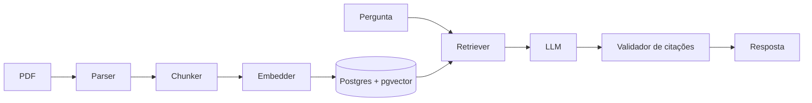

# DocuMind

**Perguntas e respostas sobre documentos técnicos com RAG, citações verificáveis e avaliação quantitativa de estratégias de recuperação.**

> 🚧 Em desenvolvimento — acompanhe o progresso no [roadmap](docs/ROADMAP.md).

<!-- TODO (M7): GIF da demo aqui -->

## Por que este projeto

Ligar um PDF a um chatbot é fácil. O difícil é saber **se a resposta está certa**, **de onde ela veio** e **se uma forma de buscar no documento é melhor que outra**. O DocuMind trata essas três perguntas como requisitos:

- **Citações verificadas por código** — cada afirmação aponta para documento, página e um trecho literal, e o sistema confere que esse trecho existe de verdade antes de exibi-lo.
- **Recusa honesta** — se a resposta não está nos documentos, o sistema diz isso em vez de inventar.
- **Estratégias comparadas com números** — busca densa, lexical, híbrida (RRF) e híbrida com reranking, em duas estratégias de chunking, avaliadas num dataset anotado à mão com split dev/test.

## Funcionalidades

- Upload de PDFs via API, com deduplicação e preservação de página/posição de cada trecho
- `POST /query`: resposta em português com citações `documento · página · trecho`
- `POST /search`: só a recuperação, para inspecionar o que o sistema encontrou
- Estratégia de recuperação escolhida por requisição
- Harness de avaliação reprodutível (`make eval`) com métricas de recuperação e de geração

## Resultados

<!-- TODO (M6): tabela gerada por eval/results/SUMMARY.md — apenas números produzidos pelo harness, no split test -->

| Chunking | Estratégia | Hit@5 | Recall@5 | MRR | Faithfulness | Recusa correta |
|----------|------------|-------|----------|-----|--------------|----------------|
| — | — | — | — | — | — | — |

Análise completa e exemplos de erro em [docs/RESULTS.md](docs/RESULTS.md).

## Arquitetura



Detalhes em [docs/ARCHITECTURE.md](docs/ARCHITECTURE.md).

**Stack:** Python 3.12 · FastAPI · PostgreSQL + pgvector · PyMuPDF · sentence-transformers · cross-encoder reranker · Gemini · Docker · GitHub Actions

## Como rodar

<!-- TODO (M7): validar estes comandos do zero -->

```bash
cp .env.example .env
docker compose up -d
make migrate && make dev
```

API em http://localhost:8000/docs.

## Decisões técnicas

As principais escolhas e os trade-offs estão registrados como ADRs em [docs/adr/](docs/adr/) — por exemplo, por que [pgvector](docs/adr/0001-pgvector-como-vector-store.md) e por que o núcleo [não usa framework de RAG](docs/adr/0002-nucleo-sem-framework-rag.md).

## Documentação

- [Especificação](docs/SPEC.md) — escopo, requisitos e não-objetivos
- [Arquitetura](docs/ARCHITECTURE.md) — componentes, dados, API
- [Plano de avaliação](docs/EVALUATION.md) — dataset, métricas e metodologia
- [Roadmap](docs/ROADMAP.md)

## Limitações conhecidas

- Apenas PDFs com camada de texto (sem OCR)
- Perguntas independentes, sem histórico de conversa
- Dataset de avaliação pequeno: diferenças pequenas entre estratégias podem ser ruído

## Autor

Gabriel Almeida Ermenegildo — [GitHub](https://github.com/gabriel-ermenegildo) · [LinkedIn](https://linkedin.com/in/gabriel-almeida-52645a210)
